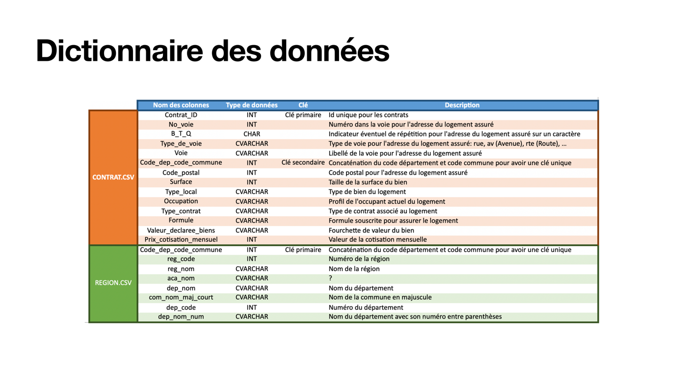
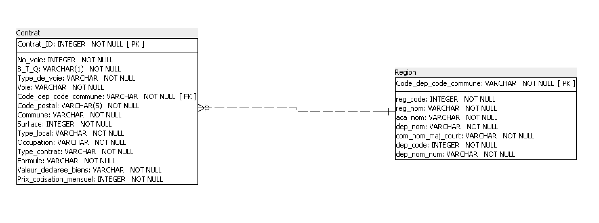

# Base de données d'assurance habitation — modélisation et requêtes SQL

> La base relationnelle a été conçue à partir de fichiers bruts de contrats. Les 12 questions métier y sont traitées en SQL, de la simple sélection au `GROUP BY … HAVING`.



**Projet 3 · OpenClassrooms Data Analyst · novembre 2025** · SQLite · DB Browser for SQLite · Modélisation relationnelle

---

## Besoin métier
Un assureur habitation stocke ses contrats dans des fichiers à plat. L'équipe veut une base interrogeable pour répondre à des questions récurrentes : volumes par territoire, surfaces, cotisations, formules souscrites.

## Données
- **Sources :** 2 fichiers. Contrats (≈ 31 000 contrats avec adresse, surface, type de local, formule, valeur déclarée, cotisation) et référentiel géographique (commune, département, région, académie).
- **Qualité :** la clé de jointure (code département + code commune) a dû être harmonisée entre les deux fichiers.
- **Limite :** les données sont fictives et fournies pour l'exercice (adresses comprises) ; elles ne sont donc pas publiées ici.

## Démarche
1. Rédiger un **dictionnaire des données** : type, longueur, règle de gestion de chaque champ.
2. Construire le **schéma relationnel** : deux tables reliées par une clé étrangère sur le code commune.
3. Implémenter la base sous SQLite ([`sql/create_tables.sql`](sql/create_tables.sql)) et charger les données.
4. Écrire les **12 requêtes** demandées ([`sql/requetes.sql`](sql/requetes.sql)) et contrôler leurs résultats.



## Résultats
| Question | Résultat |
|---|---|
| Cotisation mensuelle moyenne | 19,33 € |
| Région avec le plus de contrats | Île-de-France (14 177) |
| Cotisation moyenne la plus élevée | Paris (36,40 €/mois) |
| Formules « Intégral » en Pays de la Loire | 589 |
| Surface moyenne des contrats parisiens | 51,8 m² |
| Commune comptant le plus de contrats | Paris 18e (515) |

## Limites et pistes
- Le modèle ne compte que 2 tables. Une table « commune » distincte de la région éviterait de répéter les libellés (normalisation 3NF).
- La valeur déclarée est stockée en tranches de texte, ce qui empêche les calculs numériques.
- **Pistes :** ajouter des index sur la clé de jointure et restituer les résultats dans Power BI.

## Compétences mobilisées
`SQL` · `SQLite` · `Modélisation relationnelle` · `Dictionnaire de données` · `Jointures` · `Agrégations`

## Contenu
```
sql/
  create_tables.sql      # création des tables et des contraintes
  requetes.sql           # 12 requêtes métier
livrables/
  Cabart_Leo_1_document_technique_112025.pdf     # dictionnaire, schéma, code de création
  Cabart_Leo_2_requetes_resultats_112025.pdf     # captures d'exécution des 12 requêtes
  Cabart_Leo_3_methodologie_112025.pdf           # présentation de la démarche
images/schema_relationnel.png
```

---
Leo Cabart · Data Analyst · [Portfolio](https://lcabart21.github.io) · [GitHub](https://github.com/lcabart21)
